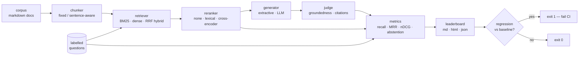

# ragproof

[](https://github.com/Kaveri0363/ragproof/actions/workflows/ci.yml)


**A RAG pipeline is code without a compiler.** Change the chunk size, swap the embedder,
add a reranker — nothing fails, nothing warns, and retrieval quality moves several points
in a direction nobody measured. `ragproof` makes that change visible: it evaluates
retrieval-augmented generation pipelines against a labelled set, compares variants on one
leaderboard, and **fails CI when retrieval quality regresses**.

It runs end to end in about two seconds with no API key, no model download and no GPU, so
the numbers below reproduce exactly on a clean clone.

```bash
pip install -e ".[dev]"
ragproof eval --config configs/default.yaml
```

---

## Results on the bundled benchmark

18 payment-platform runbooks, 52 hand-labelled questions (47 answerable, 5 deliberately
unanswerable), k=3. Every row is one line of YAML different from the row above it.

| System | Recall@3 | MRR | nDCG@3 | Precision@3 | Answer F1 | Abstain acc. | Answer rate | Latency |
|---|---|---|---|---|---|---|---|---|
| `bm25-baseline` | **0.957** | **0.989** | **0.959** | 0.486 | 0.378 | 0.60 | **0.979** | 0.4 ms |
| `bm25-fixed-chunks` | **0.957** | **0.989** | **0.959** | 0.493 | 0.367 | 0.60 | **0.979** | 0.4 ms |
| `bm25-small-chunks` | 0.925 | 0.957 | 0.922 | **0.684** | 0.383 | 0.60 | **0.979** | 0.3 ms |
| `hybrid-rrf-reranked` | 0.925 | 0.968 | 0.930 | 0.461 | 0.375 | 0.60 | **0.979** | 1.8 ms |
| `hybrid-rrf` | 0.915 | 0.933 | 0.895 | 0.429 | 0.380 | 0.60 | **0.979** | 0.8 ms |
| `dense-hashing` | 0.851 | 0.816 | 0.792 | 0.397 | **0.395** | 0.60 | 0.915 | 0.5 ms |

Broken out by question type — which is where the averages stop being useful:

| System | lookup (19) | paraphrase (9) | reasoning (13) | multi-doc (6) |
|---|---|---|---|---|
| `bm25-baseline` | **1.000** | **1.000** | **1.000** | **0.667** |
| `hybrid-rrf-reranked` | **1.000** | **1.000** | 0.923 | 0.583 |
| `dense-hashing` | 0.947 | 0.778 | 0.923 | 0.500 |

### What the benchmark actually says

**1. BM25 beats the hybrid pipeline here, and that is the finding.**
On keyword-dense technical documentation — BICs, reason codes, `IntrBkSttlmDt`, HTTP
status codes — exact lexical matching is extremely strong, and fusing in a weaker dense
signal *drags the ranking down* (0.957 → 0.915 Recall@3). The industry default of
"retrieval means embeddings" costs 4 points of recall and 2× the latency on this corpus.
A hybrid pipeline is a hypothesis, not an upgrade.

**2. Reranking must refine the first stage, not replace it.**
The first version of the lexical reranker scored candidates purely on query-term coverage
and threw away the retriever's ordering. Recall@5 fell from **0.957 to 0.713** — the
"improvement" was the single most damaging change in the project. Folding the first-stage
rank back in as a prior (`1/(k + rank)`, 30% weight) recovered it to 0.925. This is
exactly the class of regression the CI gate exists to catch.

**3. Chunk boundaries mattered less than expected; the title mattered more.**
Sentence-aware chunking scored identically to naive fixed windows at the same size.
What did move the needle was indexing each chunk *with its document title*: a chunk from
the middle of a document loses the one line saying what the document is about. Adding it
fixed `q014` outright and lifted MRR from 0.957 to 0.989.

**4. The abstention threshold was tuned, not guessed — and the original default was
strictly worse.**
The eval set contains 5 questions the corpus cannot answer; retrieval always returns
*something*, so refusing to answer has to be an explicit, tunable decision.
`configs/abstention-sweep.yaml` sweeps that threshold:

| Threshold | Answer rate (answerable) | Abstain acc. (unanswerable) |
|---|---|---|
| 0.15 | 1.000 | 0.20 |
| **0.25** | **0.979** | **0.60** |
| 0.34 | 0.702 | 0.60 |
| 0.45 | 0.425 | 1.00 |
| 0.60 | 0.213 | 1.00 |

The project's original default of 0.34 is *dominated*: 0.25 refuses exactly as many bad
questions while answering 28 points more of the good ones. The default was changed on the
strength of this table. Above 0.45 the system is perfectly safe and nearly useless — which
is the honest shape of this trade-off, and the reason it belongs on the leaderboard rather
than in a constant somewhere.

**5. Precision and recall pull in opposite directions on chunk size.**
Halving the chunk size raised Precision@3 from 0.486 to 0.684 while costing 3 points of
recall. Neither is "better": with a generous generation context, recall wins; with a tight
token budget, precision does. The harness exists so that trade is made with numbers.

---

## The CI gate

`ragproof check` diffs a run against a committed baseline and exits non-zero on any
regression beyond tolerance:

```console
$ ragproof check --results results/default.json --baseline results/baseline.json
✗ 2 regression(s) vs baseline:
    hybrid-rrf-reranked: recall_at_k 0.925 → 0.713 (-0.212)
    hybrid-rrf-reranked: mrr 0.968 → 0.745 (-0.223)
```

`.github/workflows/ci.yml` runs it on every pull request, publishes the leaderboard to the
job summary, and uploads the HTML report as an artifact. Retrieval quality is checked like
a unit test, because it is one.

---

## How it works



Each stage is swappable from YAML, and every stage is ablatable, which is the only way to
attribute a score change to a cause:

```yaml
systems:
  - name: hybrid-rrf-reranked
    chunking: { strategy: sentence, size: 120, overlap: 30 }
    retriever:
      kind: hybrid
      rrf_k: 60
      retrievers:
        - { kind: bm25 }
        - { kind: dense, embedder: { kind: hashing, dim: 1024 } }
    reranker: { kind: lexical }
    generator: { kind: extractive, abstain_threshold: 0.25 }
    judge: { kind: overlap }
```

### What gets measured

| Metric | Question it answers |
|---|---|
| Recall@k | Did the gold document make the context window at all? The ceiling on everything downstream. |
| Precision@k | How much of the context is wasted on irrelevant text? |
| MRR / nDCG@k | Was it ranked first, or fifth? Position matters when the generator sees a truncated context. |
| Groundedness | Does the answer follow from the retrieved text, or was it invented? |
| Citation precision | Does every cited document id actually appear in what was retrieved? |
| Abstain accuracy | Does the system refuse the questions the corpus cannot answer? |
| Answer rate | Of the questions it *could* answer, how many did it actually attempt? The other half of abstention. |
| Answer F1 | Token overlap with the reference answer — a cheap, deterministic floor. |

Two deliberate scoring rules: metrics are computed over **distinct documents**, so five
chunks of one document cannot inflate recall; and groundedness is scored **only on answers
that were actually given**, because folding an abstention in at 0.0 would conflate
"refused" with "hallucinated" — opposite failures needing opposite fixes.

### Why the defaults are deterministic

The default embedder is a hashed TF-IDF projection and the default judge is an n-gram
entailment proxy. Neither is state of the art, and neither is meant to be. They make the
whole harness reproducible bit-for-bit in CI with no network, no key and no sampling
noise, so that when a number moves, the *pipeline* is what changed. Real components drop
in when you want them:

```yaml
retriever: { kind: dense, embedder: { kind: sentence-transformers } }   # pip install '.[dense]'
generator: { kind: llm, provider: anthropic, model: claude-sonnet-4-5 } # pip install '.[llm]'
judge:     { kind: llm }
```

An LLM judge is non-deterministic and costs money per run, so it belongs in a nightly job,
not in the gate that blocks a pull request.

---

## Using it

```console
$ ragproof lint  --config configs/default.yaml     # validate corpus + labels first
$ ragproof eval  --config configs/default.yaml     # leaderboard → md, html, json
$ ragproof eval  --config configs/chunking-sweep.yaml
$ ragproof eval  --config configs/abstention-sweep.yaml --sort-key answer_rate
$ ragproof check --results results/default.json --baseline results/baseline.json
$ ragproof ask   "what happens if sanctions screening times out?"
$ ragproof explain --results results/default.json --system bm25-baseline --qid q021
```

`ask` runs a single question through a configured pipeline and prints the retrieved chunks
with scores; `explain` shows why one question scored the way it did, including the specific
sentences the judge marked unsupported. Debuggability is not optional in an eval harness —
a metric you cannot drill into is a metric you will not trust.

### Point it at your own documents

```yaml
corpus: ./my-docs        # any folder of .md / .txt
dataset: ./my-qa.jsonl   # {"qid", "question", "gold_doc_ids", "reference_answer", "category"}
```

`ragproof lint` treats the labelled set as code: duplicate ids, empty questions, and gold
documents that do not exist in the corpus all fail before a single number is produced.
Most of the time lost to a bad eval is lost to a bad eval *set*.

---

## Layout

```
src/ragproof/
  corpus.py       document loading, fixed and sentence-aware chunking
  text.py         tokenisation (keeps pacs.008 and payment_id intact)
  embeddings.py   deterministic hashing embedder + sentence-transformers
  retrievers.py   BM25 (implemented here), dense cosine, RRF hybrid
  rerank.py       lexical reranker with a first-stage prior; cross-encoder
  generation.py   extractive generator with abstention; LLM generator
  judge.py        groundedness, citation precision, unsupported sentences
  metrics.py      recall, precision, MRR, nDCG, token F1
  dataset.py      labelled set loading and validation
  runner.py       experiment execution, per-category aggregation
  report.py       markdown + HTML leaderboard, baseline diff
  cli.py          eval · check · lint · ask · explain
configs/          experiment definitions
data/             18 documents, 52 labelled questions
tests/            56 tests
```

## Limitations, honestly

- The bundled corpus is 18 documents. Conclusions about BM25 versus dense retrieval hold
  for small, keyword-dense technical corpora and should not be generalised further.
- The hashing embedder is a lexical projection, not a semantic model — it cannot match
  "held" to "blocked". The dense row is a floor, not a verdict on dense retrieval.
- Groundedness sits near 1.0 for every configuration because the default generator is
  extractive and therefore grounded by construction. That column only becomes informative
  with `generator: { kind: llm }`.
- Answer F1 penalises correct answers phrased differently from the reference. It is a
  regression tripwire, not a quality score.

## Next

- Query rewriting and HyDE as ablatable stages, since multi-doc recall (0.667) is the
  weakest category and single-vector retrieval is the reason.
- Bootstrap confidence intervals on the leaderboard, so "0.925 vs 0.936" comes with a
  statement about whether 52 questions can tell those apart. (They probably cannot.)
- Cost and token accounting per system, to make the quality/latency/cost trade explicit.

## License

MIT
